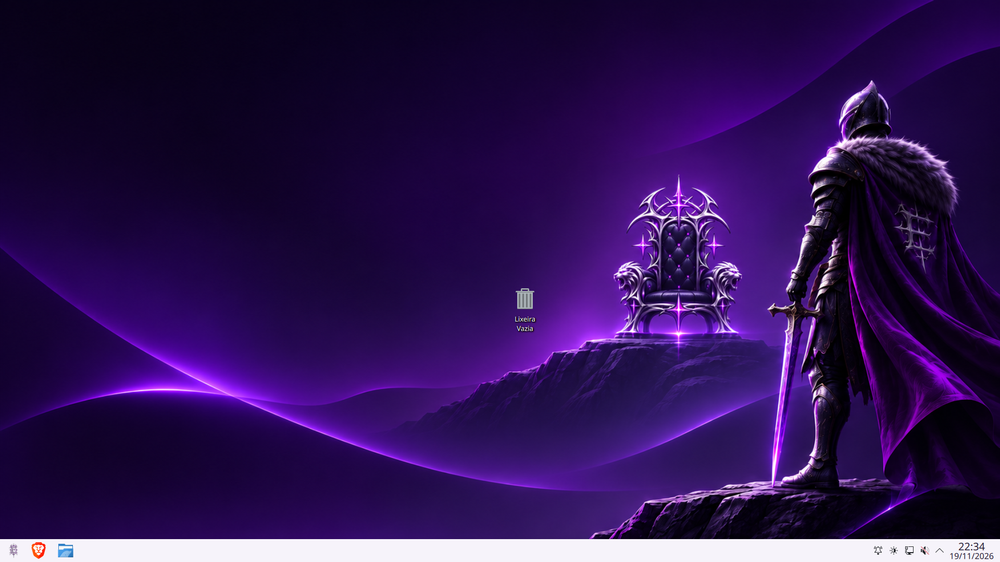
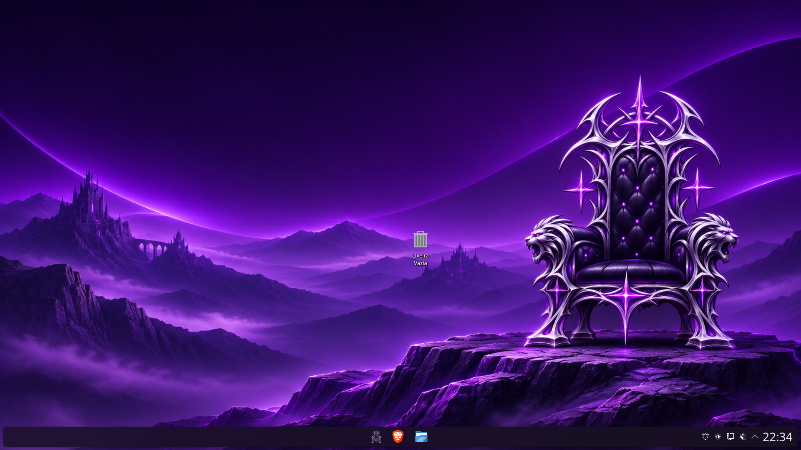
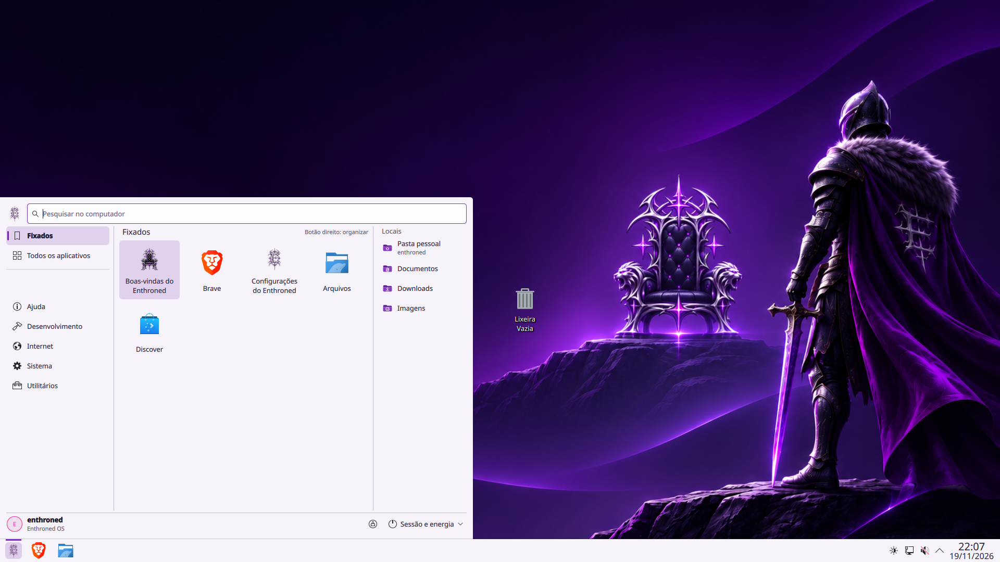
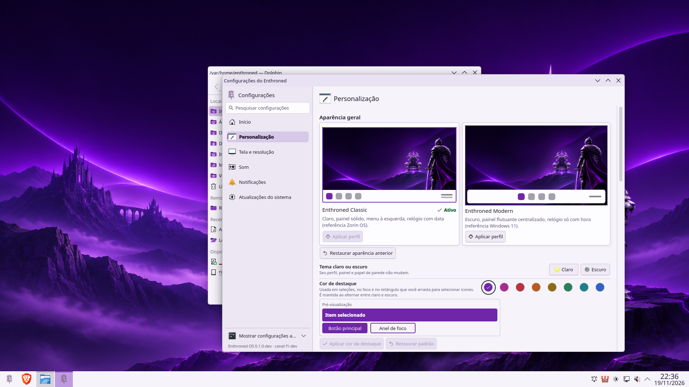
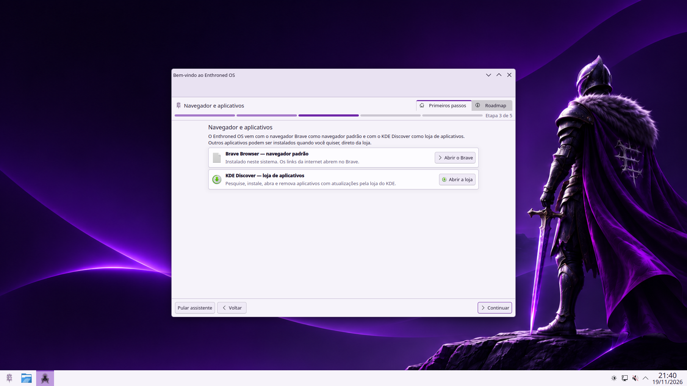
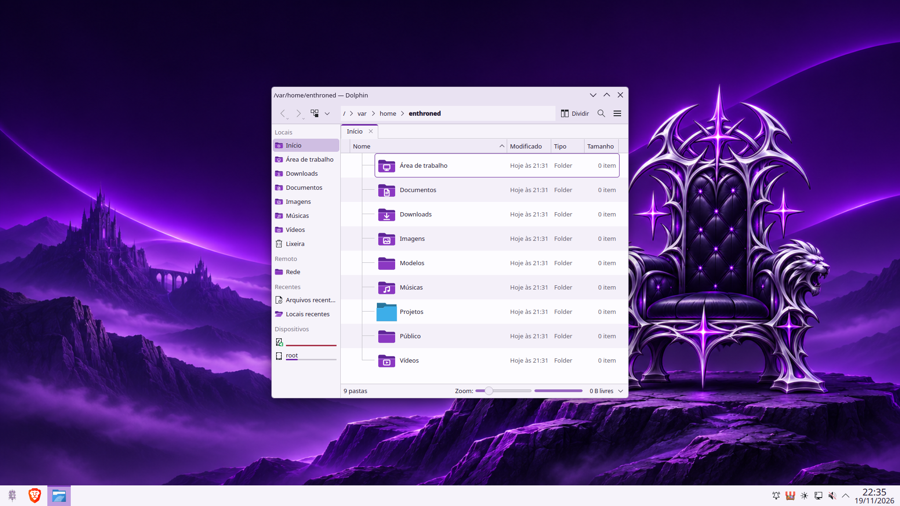
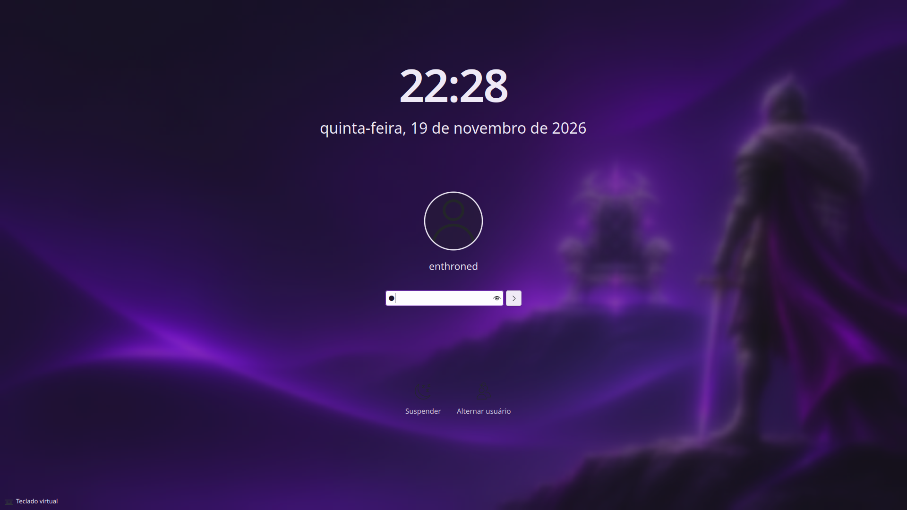

# Enthroned OS

[Português (Brasil)](README.pt-BR.md)

Enthroned OS is a customizable Linux desktop built on Universal Blue's Aurora Stable, a Fedora Atomic and KDE Plasma system. It pairs a familiar desktop layout with its own wallpapers, icons, color schemes, Start menu, and setup tools.

> **Development preview.** The H7 development image was built and validated internally in VirtualBox (real Plasma session, update safety, and measured boots). There is no public installer, downloadable ISO, or production update channel. See [Status and known limitations](#status-and-known-limitations).

## Screenshots

| | |
| --- | --- |
|  |  |
|  |  |
|  |  |
|  | |

Real captures from the H7 image at 1920×1080 with a Brazilian Portuguese session. [Capture details](docs/screenshots/README.md)

## Desktop experience

| Feature | What you can do |
| --- | --- |
| **Enthroned Classic and Modern** | Choose a light layout with a solid panel and a left-aligned Start button, or a dark layout with a floating, centered panel. Both profiles use Enthroned artwork and Plasma controls. |
| **Start menu** | Find apps through search or categories, pin favorites, and open common folders and session controls. KDE's Kickoff is available as an alternative. |
| **Enthroned Settings** | Switch profiles and personalize the desktop from one place. Adjust the appearance, accent color, wallpaper, and file manager preferences, or open the relevant KDE settings for more controls. |
| **Enthroned Welcome** | Choose a desktop profile on first sign-in, see which apps are ready, and request the optional ArtCraft Launcher when installation is enabled. You can skip setup and reopen it later. |
| **Wallpapers and artwork** | Five Enthroned wallpaper sets, plus Enthroned icons, folder colors, and color schemes. |
| **Files and apps** | Browse files in Dolphin with Enthroned folder icons, tab support, and shortcuts to common folders. KDE Discover provides the Flatpak app catalog. First-boot provisioning installs Brave from Flathub when the network and Flathub are available. |

## Updates

The Update Center in Enthroned Settings reads system deployment and update status through bootc and system services. The source includes guarded system and Flatpak update paths and a bootc rollback path. H7 confirmed on a real Plasma session that the interface reports the closed channel and blocks changes. The update channel is closed by design (`f1-dev`, not production-ready), and no image source is published. Public system updates and rollback through the Update Center still need release validation with an approved Enthroned image source. [Update design and safeguards](docs/operations/UPDATE-SYSTEM.md)

## Status and known limitations

- **Distribution.** The pipeline produces an OCI bootc image and disk images for internal testing. It does not produce an installable ISO, and there is no official installation procedure for users.
- **Tested configuration.** A 64-bit VirtualBox guest with EFI, four virtual CPUs, 8 GiB of RAM, and VMSVGA graphics. Minimum specifications and physical hardware support are not established. Battery and AC, physical Wi-Fi and Ethernet, docks and hotplug, Bluetooth, and accessibility presets with real input devices were not tested.
- **Boot time.** In VirtualBox, clean boots of the H7 image reached `graphical.target` in about 80–83 seconds. The 35-second target has not been met. The first boot took about 5 minutes, mostly because `flatpak-preinstall.service`, a unit inherited from the Aurora base, downloads Flatpak runtimes on the critical path. That unit has not been optimized yet. These numbers come from an emulated VM and do not represent physical hardware.
- **Not exercised yet.** bootc rollback and an update from a published image source.

## Build and development

For local image development, run the following from the source tree on Linux or WSL2 with Podman, Just, Git, and jq. The image build uses rootful Podman and builds and tests the native apps inside the container. [Build recipes](Justfile) · [Build guide](docs/operations/BUILD.md)

```bash
just doctor
just verify-source
just build
just verify-image
```

Two files hold the placeholder `SET_ME_BEFORE_PUBLISH`: [`image-template.env`](image-template.env) and [`disk_config/iso.toml`](disk_config/iso.toml). It is deliberate. It stands in for a registry namespace that does not exist yet: while it is set, the installer-media recipe refuses to run and the build leaves out the source URL labels. It is not an operational configuration. Local test disks need a user file, `disk_config/vm.local.toml`, which you create from [`vm.example.toml`](disk_config/vm.example.toml). It is ignored by Git, and no default password is provided.

## Architecture

The [Containerfile](Containerfile) layers the desktop and system configuration in [`system_files/`](system_files/) onto Aurora Stable. bootc uses OCI images for transactional system deployments. [Desktop architecture](docs/architecture/ENTHRONED-DESKTOP-ARCHITECTURE.md)

[Settings](settings/) and [Welcome](welcome/) use Qt Quick, Kirigami, and C++. The image also includes a native Plasma desktop actions plugin and the Enthroned launcher plasmoid. [First-run architecture](docs/architecture/ENTHRONED-FIRST-RUN-ARCHITECTURE.md)

## License and credits

Original source code is licensed under [Apache-2.0](LICENSE). The Enthroned wallpapers, logos, and derived artwork are under a separate [artwork license](LICENSES/LicenseRef-Enthroned-Artwork.txt), and the Enthroned name and logos are covered by [TRADEMARKS.md](TRADEMARKS.md). Forks must replace the artwork and use their own name. Third-party components keep their own licenses. Enthroned OS builds on the work of Universal Blue, Fedora, KDE, the bootc project, and Qt. The third-party inventory records upstream sources and notices for adapted material. [Third-party licenses and attribution](docs/licensing/THIRD-PARTY.md)
