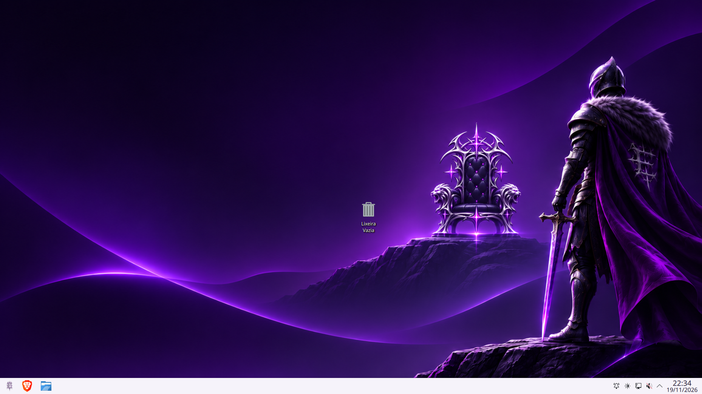
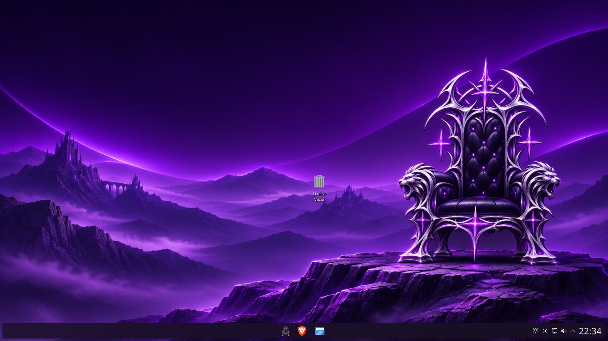
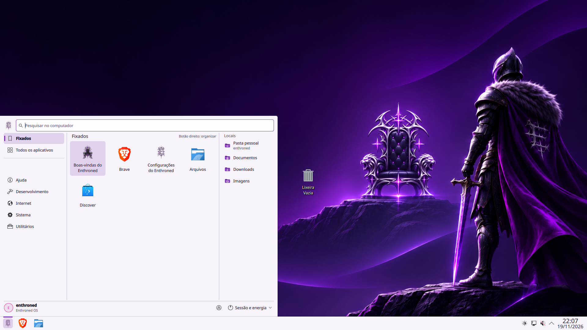
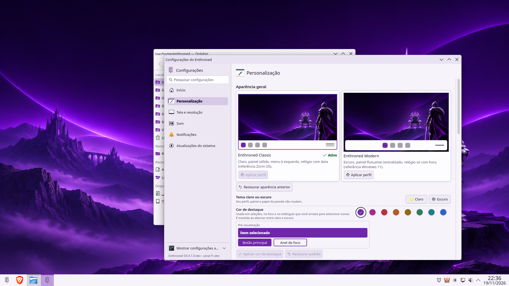
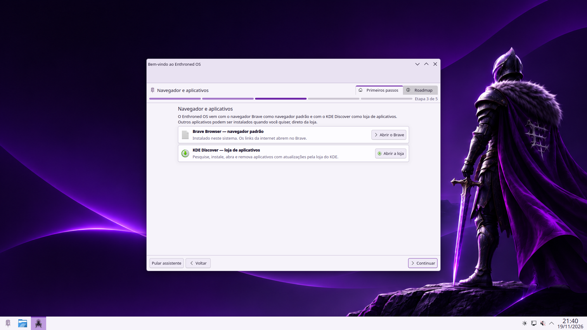
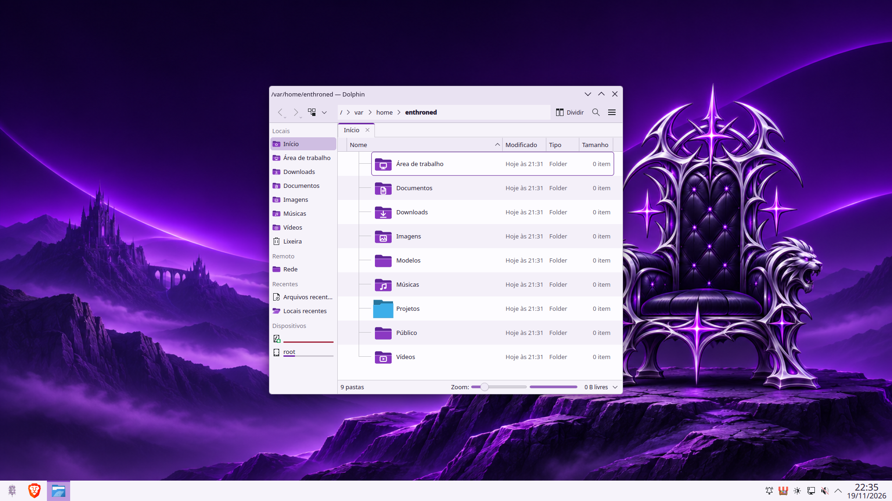
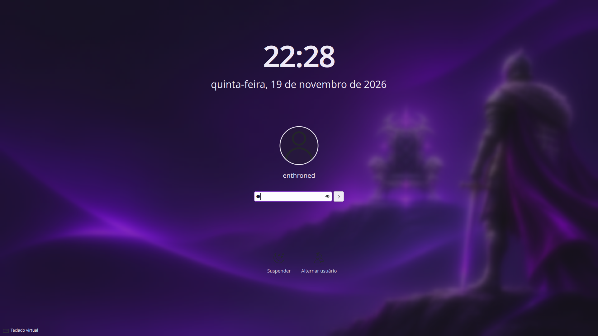

# Enthroned OS

[English](README.md)

O Enthroned OS é um desktop Linux personalizável construído sobre o Aurora Stable, da Universal Blue, que combina Fedora Atomic e KDE Plasma. A organização familiar da área de trabalho vem acompanhada de papéis de parede, ícones, esquemas de cores, Menu Iniciar e ferramentas de configuração próprios.

> **Versão em desenvolvimento.** A imagem de desenvolvimento H7 foi construída e homologada internamente no VirtualBox (Plasma real, segurança das atualizações e boots medidos). Ainda não há instalador público, ISO para download ou canal de atualizações de produção. Veja [Estado e limitações conhecidas](#estado-e-limitações-conhecidas).

## Capturas de tela

| | |
| --- | --- |
|  |  |
|  |  |
|  |  |
|  | |

Capturas reais da imagem H7 em 1920×1080, em uma sessão em português (Brasil). [Detalhes das capturas](docs/screenshots/README.md)

## Experiência desktop

| Recurso | O que você pode fazer |
| --- | --- |
| **Enthroned Classic e Modern** | Escolha entre um layout claro, com painel sólido e botão Iniciar à esquerda, e um layout escuro, com painel flutuante e centralizado. Os dois perfis usam a arte do Enthroned e os controles do Plasma. |
| **Menu Iniciar** | Encontre aplicativos pela busca ou pelas categorias, fixe favoritos e acesse pastas comuns e controles de sessão. O Kickoff do KDE está disponível como alternativa. |
| **Enthroned Settings** | Troque de perfil e personalize a área de trabalho em um só lugar. Ajuste a aparência, a cor de destaque, o papel de parede e as preferências do gerenciador de arquivos ou abra as configurações do KDE para acessar mais controles. |
| **Enthroned Welcome** | Escolha um perfil no primeiro login, veja quais aplicativos estão disponíveis e solicite o ArtCraft Launcher quando a instalação opcional estiver habilitada. Você pode pular o assistente e reabri-lo depois. |
| **Papéis de parede e arte** | Cinco conjuntos de papéis de parede do Enthroned, além de ícones, cores de pastas e esquemas de cores próprios. |
| **Arquivos e aplicativos** | Navegue no Dolphin com ícones de pastas do Enthroned, abas e atalhos para pastas comuns. O KDE Discover oferece o catálogo de aplicativos Flatpak. A configuração inicial instala o Brave pelo Flathub quando há acesso à rede e ao Flathub. |

## Atualizações

A Central de Atualizações do Enthroned Settings consulta o estado das implantações do sistema e das atualizações por meio do bootc e de serviços do sistema. O código inclui fluxos protegidos de atualização do sistema e dos Flatpaks, além da reversão pelo bootc. A H7 confirmou no Plasma real que a interface informa o fechamento do canal e bloqueia alterações. O canal de atualizações está fechado de propósito (`f1-dev`, sem status de produção) e nenhuma origem de imagem está publicada. As atualizações públicas do sistema e a reversão pela Central ainda dependem de validação com uma origem de imagem Enthroned aprovada. [Arquitetura e proteções das atualizações](docs/operations/UPDATE-SYSTEM.md)

## Estado e limitações conhecidas

- **Distribuição.** O pipeline gera uma imagem OCI bootc e discos para testes internos. Ele não gera uma ISO instalável, e não existe procedimento oficial de instalação para usuários.
- **Configuração testada.** VM de 64 bits no VirtualBox com EFI, quatro CPUs virtuais, 8 GiB de RAM e vídeo VMSVGA. Os requisitos mínimos e o suporte a hardware físico não foram definidos. Não foram testados bateria e energia, Wi-Fi e Ethernet físicos, docks e hotplug, Bluetooth nem os presets de acessibilidade com dispositivos de entrada reais.
- **Tempo de boot.** No VirtualBox, os boots limpos da imagem H7 chegaram ao `graphical.target` em cerca de 80 a 83 segundos. A meta de 35 segundos ainda não foi atingida. O primeiro boot levou cerca de 5 minutos, principalmente porque o `flatpak-preinstall.service`, unidade herdada da base Aurora, baixa os runtimes Flatpak no caminho crítico. Essa unidade ainda não foi otimizada. Os números vêm de uma VM emulada e não representam hardware físico.
- **Ainda não exercitado.** Reversão pelo bootc e atualização a partir de uma origem de imagem publicada.

## Build e desenvolvimento

Para desenvolver a imagem localmente, execute os comandos abaixo na raiz do código-fonte, em Linux ou WSL2 com Podman, Just, Git e jq. A build usa Podman com privilégios e compila e testa os aplicativos nativos dentro do contêiner. [Receitas de build](Justfile) · [Guia de build](docs/operations/BUILD.md)

```bash
just doctor
just verify-source
just build
just verify-image
```

Dois arquivos contêm o placeholder `SET_ME_BEFORE_PUBLISH`: [`image-template.env`](image-template.env) e [`disk_config/iso.toml`](disk_config/iso.toml). Ele é intencional e representa um namespace de registro que ainda não existe: enquanto estiver definido, a receita de mídia de instalação se recusa a rodar e a build omite os rótulos com a URL de origem. Não é uma configuração operacional. Os discos de teste locais precisam de um arquivo de usuário, `disk_config/vm.local.toml`, que você cria a partir de [`vm.example.toml`](disk_config/vm.example.toml). Ele é ignorado pelo Git e nenhuma senha padrão é fornecida.

## Arquitetura

O [Containerfile](Containerfile) acrescenta ao Aurora Stable a camada desktop e as configurações de sistema em [`system_files/`](system_files/). O bootc usa imagens OCI para implantações transacionais do sistema. [Arquitetura desktop](docs/architecture/ENTHRONED-DESKTOP-ARCHITECTURE.md)

O [Settings](settings/) e o [Welcome](welcome/) usam Qt Quick, Kirigami e C++. A imagem também inclui um plugin nativo de ações da área de trabalho e o plasmoide do menu Enthroned. [Arquitetura da primeira experiência](docs/architecture/ENTHRONED-FIRST-RUN-ARCHITECTURE.md)

## Licença e créditos

O código-fonte original está licenciado sob [Apache-2.0](LICENSE). Os papéis de parede, os logotipos e as artes derivadas do Enthroned usam uma [licença de artes](LICENSES/LicenseRef-Enthroned-Artwork.txt) separada, e o nome e os logotipos são regidos por [TRADEMARKS.md](TRADEMARKS.md). Forks devem substituir as artes e usar o próprio nome. Componentes de terceiros mantêm suas próprias licenças. O Enthroned OS usa o trabalho da Universal Blue, do Fedora, do KDE, do projeto bootc e do Qt. O inventário de terceiros registra as fontes upstream e os avisos do material adaptado. [Licenças e atribuições de terceiros](docs/licensing/THIRD-PARTY.md)
